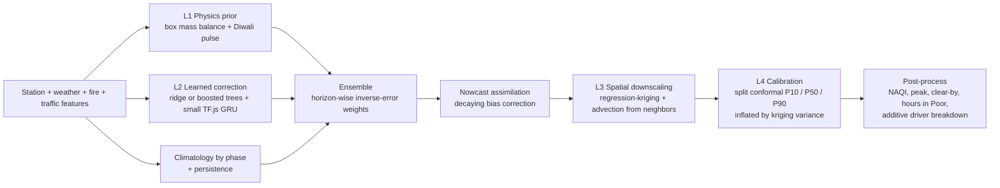
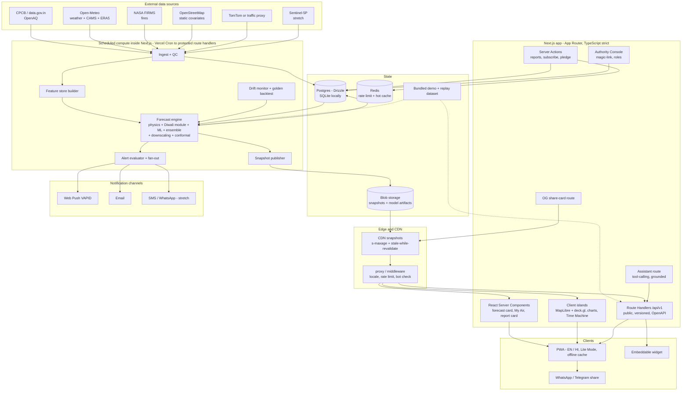
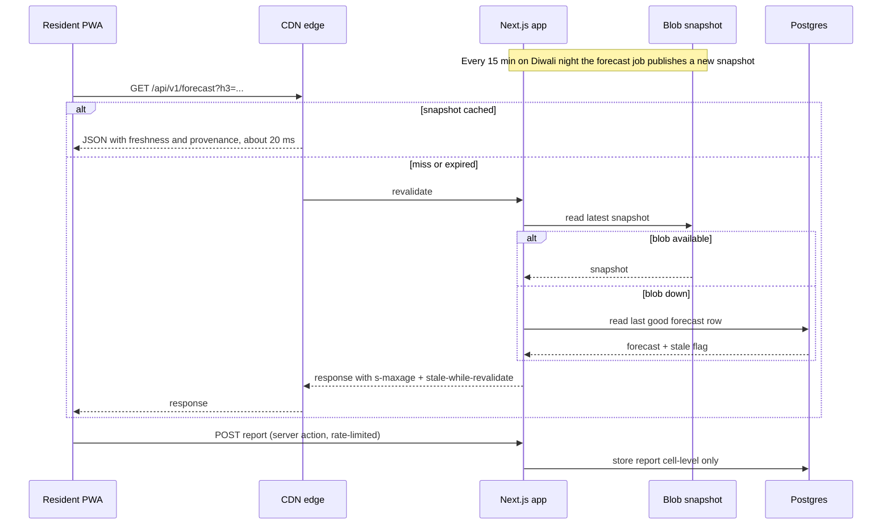

# VayuNetra — Master Product Requirements Document

> **VayuNetra** (*Vayu* = air, *Netra* = eye) — *the eye that sees your air before it arrives.*
> Street-level, explainable, AI-driven air-pollution forecasts for the Diwali window: **before, during and after**.

| | |
|---|---|
| **Event** | Paryavaran Welfare Society Hackathon |
| **Problem statement** | AI-Powered Neighborhood-Level Air Pollution Prediction System — predict neighborhood-level air pollution before, during and after Diwali using historical air-quality data, weather, traffic and other environmental indicators |
| **Stack constraint** | Next.js full-stack only (TypeScript everywhere; no Python or separate backend service) |
| **Pilot geography** | Delhi-NCR (densest public monitoring network, strongest Diwali signal) |
| **Version** | 1.0 — Master PRD (merge of PRD 1–5) |
| **Date** | 31 Oct 2026 |
| **Key dates** | Choti Diwali Sat 7 Nov · **Diwali Sun 8 Nov 2026** · Govardhan Puja Mon 9 Nov |
| **Status** | Approved scope for build; P0 = demo-critical |

> Name is a working title. Nothing in the architecture depends on it (see §26 for alternates).

---

## Table of contents

1. Executive summary
2. Problem and opportunity
3. Vision, goals, non-goals
4. How this master PRD was assembled
5. Personas
6. How we are different
7. The Diwali Phase Engine
8. Master feature catalogue
9. Detailed feature requirements
10. User journeys
11. Forecast methodology
12. Data strategy
13. System architecture
14. Data model
15. API specification
16. UX, design system and accessibility
17. Security, privacy and ethics
18. Non-functional requirements
19. Success metrics
20. Testing and quality
21. Delivery plan
22. Demo and pitch plan
23. Risks and mitigations
24. Roadmap
25. Repository and Git standards
26. Open decisions and alternate names
- Appendices A–F

---

## 1. Executive summary

VayuNetra turns sparse air-quality readings into an **hour-by-hour PM2.5 forecast for every ~0.7 km² neighborhood cell** of Delhi-NCR, covering the whole festival arc: the **build-up** before Diwali, the **night burst**, and the **hangover and dispersion** after. Every number comes with an uncertainty band, a plain-language explanation of what is driving it, and a concrete action for whoever is looking at it.

### Four promises

| Promise | What the user gets |
|---|---|
| **Know** | A calibrated, neighborhood-level forecast (not a city-wide AQI), T−7 days to T+5 days, refreshed hourly (every 15 min on Diwali night) |
| **Understand** | "Why is my air bad?" — an additive breakdown into crackers, traffic, still air, regional smoke, dust and baseline, plus wind-driven transport from neighboring cells |
| **Act** | Personal health advice, safe windows, a "clear-by" time and alerts for residents; hotspot ranking, a what-if simulator and a deployment playbook for authorities |
| **Trust** | Every value is labelled MEASURED / MODELLED / CITIZEN / SYNTHETIC; every cell shows its confidence; a public report card scores us against past Diwalis |

### Why this wins

1. **It answers the problem statement literally** — neighborhood level, before/during/after Diwali, history + weather + traffic + other indicators (fires, land use, citizen reports).
2. **It is honest.** Most submissions will claim "92% accuracy" on a random split. We publish leave-one-Diwali-out and leave-one-station-out backtests, interval calibration, and our weak spots.
3. **It is a product, not a dashboard.** Residents, RWAs, officers, NGOs and researchers each have a 60-second path to value.
4. **It survives Diwali night.** Forecasts are precomputed and served from the edge; a traffic spike never touches the model or the database.
5. **It is demo-proof.** Live Mode, Replay Mode and an offline Demo Mode mean the demo works whether judging happens before, on or after Diwali, with or without Wi-Fi.
6. **It looks expensive.** Cinematic landing, a Diwali Time Machine, wind-driven plume animation, a conversational assistant grounded in the model, and a scripted Judge Mode.

---

## 2. Problem and opportunity

Air quality in Indian cities deteriorates sharply around Diwali. Cracker smoke, festive traffic, cooler nights, thermal inversion, low wind and regional crop-residue smoke stack up in the same few days. Pollution during this window is **hyperlocal**: one colony bursts crackers while the next does not; wind carries smoke across boundaries; a shallow inversion at 2 AM traps everything.

| # | Gap today | Who feels it | VayuNetra response |
|---|---|---|---|
| 1 | Few monitoring stations; one city AQI hides lane-to-lane differences | Everyone | Hex-grid downscaling with covariates + kriging |
| 2 | Forecasts are city-wide and blind to festival emissions | Residents, planners | Dedicated Diwali event-emission module and phase model |
| 3 | "AQI 340" does not say what to do | Parents, elderly, asthmatics, outdoor workers | Profile-based advisory, safe-window finder, clear-by time |
| 4 | Authorities lack ward-level, forward-looking decision support | Pollution boards, RWAs, NGOs | Hotspot ranking, what-if simulator, deployment playbook, exports |
| 5 | Predictions are black boxes with no accountability | Public, journalists, judges | Additive explainability, uncertainty bands, public report card |
| 6 | Uneven sensor coverage makes quiet areas look "fine" | Under-monitored neighborhoods | Confidence layer + trust-scored citizen reports |
| 7 | Apps show *now*, not *10 PM in my area* | Everyone | 72-hour hourly forecast with peak and clear-by times |
| 8 | English-only, smartphone-only | Low-literacy, non-smartphone users | Hindi + English, low-data mode, SMS/WhatsApp share path |

**Opportunity:** combine free public data with a transparent forecasting stack that runs entirely inside a Next.js codebase, and present it so a parent, an RWA secretary and an officer can each use it in under a minute.

---

## 3. Vision, goals, non-goals

**Vision:** every resident can see, hour by hour, what the air will do on their street this Diwali, why, and what to do about it — and every authority can see where to act first.

### Goals

| ID | Goal |
|---|---|
| G1 | Forecast PM2.5 and NAQI category per H3 res-8 cell, hourly, up to 72 h ahead, with P10/P50/P90 |
| G2 | Cover all three phases (build-up, burst, hangover) with phase-aware behaviour and messaging |
| G3 | Explain every forecast with an additive driver breakdown |
| G4 | Turn forecasts into action: advice, alerts, safe windows, clear-by time, hotspot lists, what-if scenarios, deployment playbook |
| G5 | Prove it works: leave-one-Diwali-out and leave-one-station-out backtests, live forecast-vs-actual report card |
| G6 | Stay fast and online on Diwali night under a traffic spike (edge-served snapshots, last-good fallback) |
| G7 | Be usable on a budget Android phone on 4G, in Hindi and English, with a low-data mode |
| G8 | Be honest: provenance labels, confidence badges, visible limits, methodology page |
| G9 | Be demo-proof: Live, Replay and offline Demo modes plus a scripted Judge Mode |

### Non-goals (v1)

- Not a medical device; advice follows public guidance and is labelled as such.
- Not a replacement for official CPCB data; we use it, credit it, never overwrite it.
- No custom sensor hardware; no native apps (installable PWA instead).
- No detection or tracking of individual firecrackers or individuals; no enforcement against persons.
- No forecasts beyond T+72 h in v1 (the timeline extends to T+5 days by stitching rolling forecasts and observations).
- No full CFD or HYSPLIT-class dispersion modelling; we use a simplified advection–diffusion approximation.
- No separate Python or ML service. Training is done offline via TypeScript scripts in the same repo.

---

## 4. How this master PRD was assembled

Five team PRDs were merged. **PRD 1 (PranaVayu AI) is the spine**: Delhi-NCR focus, the 3-phase Diwali model, SHAP-style attribution, the what-if policy simulator and the municipal action plan. Everything else was layered on.

| Source | What it contributed to the master |
|---|---|
| **PRD 1 — PranaVayu AI** *(base)* | Delhi-NCR 30+ micro-zone showcase; Diwali 3-phase model; XAI attribution; what-if sliders (cracker-ban compliance, odd-even); municipal action plan with anti-smog gun routing; round-based roadmap; Next.js 16 / React 19 / Tailwind v4 baseline |
| **PRD 2 — SwaasCast** | H3 hex grid; P10/P50/P90 with split-conformal calibration; provenance labels; confidence/sensor-desert layer; degradation chain; leave-one-Diwali-out + leave-one-station-out evaluation; report card; share cards + embed widget; Live/Replay modes; data-health and methodology pages; drift monitor and golden backtest; regression-kriging; ensemble + nowcast assimilation |
| **PRD 3 — SaansCast** | "Clear-by" time; four-layer model (physics prior → learned correction → downscaling → calibration); Time Machine with Forecast / Actual / Difference toggle; edge-served snapshots architecture; DEMO_MODE; citizen-report abuse controls; role-based authority view; full DB schema and versioned API; test strategy; Lighthouse targets; DPDP-aligned privacy; per-city rules files |
| **PRD 4 — AetherPulse** | Wind-advection plume animation and neighborhood adjacency graph; conversational assistant on the Vercel AI SDK; cinematic landing; command palette; compare mode; community pins; PDF/PNG briefings; "never an empty map" rule; scenario slider that re-colours the whole map live |
| **PRD 5 — SAANS** | Lunar-calendar-aligned (not Gregorian) history matching; crowd confirmation threshold (≥3); on-device decibel score (no audio upload); Clean Diwali Pledge + leaderboard; Sentinel-5P NO₂ overlay (stretch); WhatsApp/SMS channel (stretch); targeted ward alerts; researcher bulk export; RAG-lite grounded chatbot via function-calling |

### Conflict resolution log

| Conflict across PRDs | Decision | Reason |
|---|---|---|
| Python/ONNX training (PRD 5) vs Next.js-only | **TypeScript-only**: ridge/boosted regression and a small TensorFlow.js GRU, trained offline by repo scripts | Honours "just Next.js"; one language; judges can read the code |
| PostGIS + TimescaleDB (PRD 5) vs none | **H3 keys, no PostGIS**; plain Postgres (Neon) with SQLite for local | Fast lookups, zero GIS setup, trivial to cache |
| Mapbox (PRD 4/5) vs MapLibre | **MapLibre GL + deck.gl** | No token needed, no billing surprises |
| Cell size 500 m (PRD 4/5) vs ~0.7 km² (PRD 2/3) | **H3 res-8 (~0.74 km²) native; res-9 (~0.1 km²) focus zoom** by re-weighting with finer covariates | Matches real sensor density; honest about resolution |
| Ward polygons (PRD 1) vs hexes (PRD 2–5) | **Hex-native model; 30+ named ward/micro-zone roll-ups** for storytelling and authority view | Best of both: modelling honesty, human-readable places |
| Model explainability: SHAP (PRD 1) vs additive layers (PRD 2/3) | **Exact additive contributions** from the ridge member and physics layers, grouped into drivers; labelled "SHAP-style" in UI copy | Exact beats approximate; no extra compute |
| Inngest / queues (PRD 5) vs plain cron (PRD 3) | **Vercel Cron + idempotent route handlers + job log**; durable step runner optional | Fewer moving parts |
| LLM on live path (PRD 4/5) | **Assistant is an add-on, never on the critical path**; answers only from tool calls into the forecast API; templated fallback if the LLM is down | Hallucination and uptime risk |
| Mic decibel detection (PRD 5) | **P2, on-device only**, score not audio | Privacy |
| Auth for citizens (PRD 5) | **No accounts for citizens**; magic-link auth for officers only | Lower friction, better privacy |

---

## 5. Personas

| Persona | Context | Core question | Hero features |
|---|---|---|---|
| **Meera, 34 — parent** | Child with asthma, apartment complex | "Is tonight safe? When can the kids play outside again?" | My Air, Why, Advice, Clear-by, Alerts |
| **Rakesh, 52 — RWA secretary** | Runs a housing society | "Which hours and blocks are worst? What do I tell residents?" | Map, What-if Lab, Briefing PDF, Pledge |
| **Rajan, 46 — pollution control officer** | Ward-level decision maker | "Where do I send sprinklers, patrols and awareness drives first?" | Authority Console, Hotspot cards, Playbook, Exports |
| **Sana, 21 — NGO volunteer** | Campaigner, citizen scientist | "I can see smoke, the map says fine. I need shareable evidence." | Citizen Reports, Share Cards, Pledge, Embed |
| **Imran, 29 — delivery rider** | Outdoors 10 h/day, low data | "Red, amber or green? Which mask?" | Lite Mode, Advice, Safe Windows |
| **Dr. Kapoor, 55 — researcher/journalist** | Needs method and data | "Open data, transparent method, proven accuracy." | Report Card, Methodology, Open API, Bulk export |
| **Judge / visitor** | Sees the demo | "Show me something new that works and makes sense." | Judge Mode, Time Machine, Why, What-if |

---

## 6. How we are different

| Dimension | Typical submission | **VayuNetra** |
|---|---|---|
| Resolution | City or station-level AQI chart | ~0.7 km² hex grid (zoom to ~0.1 km²) with 30+ named Delhi-NCR micro-zone roll-ups |
| Festival awareness | Generic time-series model | Diwali Phase Engine: build-up ramp, night burst, hangover/dispersion; profile learned from past Diwalis, not assumed from rules |
| Spatial physics | Interpolated dots | Wind-driven advection across a neighborhood graph; plume animation |
| Uncertainty | One number | P10/P50/P90, conformally calibrated, widened in sensor deserts |
| Explainability | None or black-box SHAP image | Exact additive breakdown per cell and hour, in a waterfall and in plain language |
| Actionability | A dashboard | Advice, safe windows, **clear-by time**, alerts, what-if, deployment playbook |
| Validation | "92% accuracy" random split | Leave-one-Diwali-out + leave-one-station-out; public report card; skill vs persistence/climatology/CAMS |
| Ground truth | Official feeds only | Official feeds + trust-scored citizen reports (never overriding stations) |
| Resilience | Breaks if an API dies | Degradation chain, freshness badges, last-good snapshots, offline Demo Mode |
| Scale on Diwali night | Origin melts | Precomputed snapshots on CDN; origin barely touched |
| Presentation | Static charts | Time Machine, plume animation, share cards, embed widget, PWA, command palette, scripted Judge Mode |

---

## 7. The Diwali Phase Engine

The product behaves differently in each phase, driven by a per-city festival calendar and rules file (never hard-coded).

| Phase | Window (relative to Diwali night, T) | Physical story | What the product does |
|---|---|---|---|
| **P1 · Build-up** | T−7 days → T−6 h | Shopping traffic around market corridors, cooling nights, stagnant air, regional crop-residue smoke, early cracker use | Build-up forecast; "best days for outdoor work"; early alerts for the first heavy night; market-corridor traffic emphasis; refresh hourly |
| **P2 · Burst** | ≈17:00 on Choti Diwali / Diwali evening → ≈02:00 (rules and behaviour vary; learned profile governs) | Explosive cracker emission pulse, inversion trapping, local hotspots, advection across borders | 15-minute refresh; peak-time and peak-size estimate; live citizen reports; alert fan-out; plume animation; hotspot ranking; "Cracker Wave" |
| **P3 · Hangover & dispersion** | T+6 h → T+5 days | Slow decay; inversion-dependent persistence; lingering PM2.5; recovery depends on ventilation | Clear-by estimate per cell; recovery tracker; ward **Clean Air Score**; auto-generated impact report; report card |

**Phase chips** appear in the Time Machine, the forecast card and the authority console. **Event markers**: Choti Diwali, Diwali, Govardhan Puja, sunset, permitted-cracker window (config).

**Calendar integrity:** history is aligned by **festival date (lunar), not Gregorian date**. Diwali shifts each year; the phase engine uses hours-to/since Diwali night as a feature.

---

## 8. Master feature catalogue

**Priority:** **P0** = must be in the demo · **P1** = should ship · **P2** = stretch (cut first). **Src** = origin PRD number(s).

### Module A — Map & Time

| ID | Feature | What it does | Pri | Src |
|---|---|---|---|---|
| A1 | **Hyperlocal hex heatmap** | H3 res-8 grid coloured by PM2.5 / NAQI / uncertainty; zoom to res-9; 30+ named micro-zone roll-ups | P0 | 1,2,3 |
| A2 | **Diwali Time Machine** | Scrubber T−7d…T+5d (forecast core T−72h…T+72h), phase chips, autoplay 1×/4×/12×, event markers, "Cracker Wave" animation | P0 | 1,2,3,4 |
| A3 | **Forecast / Actual / Difference toggle** | Time Machine replay of past Diwalis (2021–2025): our forecast made 24 h earlier vs station actuals vs difference | P0 | 3 |
| A4 | **Wind & advection layer** | Wind arrows + animated plume showing smoke crossing cell boundaries | P1 | 4,5 |
| A5 | **Layer toggles** | Stations, citizen reports, fire hotspots, traffic, inversion risk, confidence | P1 | 1,3,4 |
| A6 | **Compare mode** | Two neighborhoods side-by-side with driver diff | P1 | 4 |
| A7 | **3D extruded hexagons** | Presentation mode for the hero shot | P2 | 3 |
| A8 | **Live / Replay / Demo modes** | Live feeds on the real night; deterministic replay of past Diwalis; bundled offline demo data | P0 | 2,3 |

### Module B — Forecast & Trust

| ID | Feature | What it does | Pri | Src |
|---|---|---|---|---|
| B1 | **Area forecast card** | P50 with P10–P90 band, category, peak time, **clear-by time**, hours above Poor, provenance badge, freshness; server-rendered | P0 | 2,3 |
| B2 | **My Air page** | 72-hour hourly chart, category strips, peak, clear-by, profile advice, deep-linkable | P0 | 3 |
| B3 | **Confidence layer & sensor-gap badge** | Distance to nearest station, reading age, band width → High/Med/Low confidence; "adopt a gap" nudge to report | P0 | 2,3 |
| B4 | **Provenance labels** | MEASURED / MODELLED / CITIZEN / SYNTHETIC on every value | P0 | 2 |
| B5 | **Report Card** | Forecast vs observed, calibration plot, MAE/RMSE/bias, category accuracy, peak error, ward error map, skill vs baselines | P1 | 2,3 |
| B6 | **Data Health page** | Source status, freshness, QC stats, job log | P1 | 2,3 |
| B7 | **Methodology & Model Card** | Plain-language "How this works", limits, sources, weak spots | P0 | 2,3 |
| B8 | **Degradation chain** | Four-level graceful fallback with visible banners | P0 | 2,3,5 |

### Module C — Explain & Simulate

| ID | Feature | What it does | Pri | Src |
|---|---|---|---|---|
| C1 | **"Why is my air bad?"** | Additive waterfall: baseline, still air, crackers, traffic, regional smoke, dust/other, + neighboring-cell advection; one plain sentence | P0 | 1,2,3,4,5 |
| C2 | **What-if Lab** | Sliders: cracker intensity / ban compliance, traffic, ventilation (wind), construction dust, sprinkling; ΔPM2.5, Δ peak time, Δ clear-by, Δ hours-in-Poor; whole map recolours live | P0 | 1,2,3,4 |
| C3 | **Diwali vs no-Diwali ghost line** | Counterfactual baseline curve beneath the forecast, isolating the festival's contribution | P1 | new |
| C4 | **Assistant "Vayu"** | Streaming chat grounded by tool calls into forecast/attribution/scenario APIs; cites cell, time, provenance; refuses medical diagnosis; template fallback | P1 | 4,5 |
| C5 | **Exposure Budget** | Personal cumulative-exposure estimate over the next 72 h expressed as a heuristic "cigarette-equivalent" figure (labelled rule of thumb), with how much a mask or staying in reduces it; shareable | P1 | new |

### Module D — Citizen

| ID | Feature | What it does | Pri | Src |
|---|---|---|---|---|
| D1 | **Health advisory engine** | Versioned deterministic rules: NAQI category × profile × activity; mask guidance; three do/don't items; "Not medical advice" | P0 | 1,2,3 |
| D2 | **Safe-window finder** | Best low-exposure slots over next 72 h per profile | P1 | 2,3,4 |
| D3 | **Smart alerts** | Web Push + email; thresholds, quiet hours, per-cell, "peak in 3 h", "safe window starts at 11 AM", recovery notice | P1 | 2,3,5 |
| D4 | **Citizen reports** | One-tap haze / smoke / burst / burning / dust; no accounts, no free text, cell-level only; rate-limited; ≥3 independent confirmations before it influences nowcasting; weight capped; shown as CITIZEN evidence | P1 | 2,3,4,5 |
| D5 | **On-device burst score** | Optional microphone decibel *score* computed on device; no audio leaves the phone | P2 | 5 |
| D6 | **Clean Diwali Pledge & leaderboard** | Pledge counter, ward leaderboard, green-cracker guidance, shareable card | P1 | 2,3,5 |
| D7 | **Share cards** | Dynamic OG image per area for WhatsApp; Hindi/English | P1 | 2,3 |
| D8 | **Institutions mode** | Go / no-go outdoor activity board for schools and RWAs (assemblies, sports, events) | P2 | new |

### Module E — Authority & Research

| ID | Feature | What it does | Pri | Src |
|---|---|---|---|---|
| E1 | **Authority Console** | Role-based (viewer / officer / admin); ward leaderboard by peak PM2.5, hours above Poor, population-weighted exposure; confidence beside every rank | P0 (lite) | 1,2,3,5 |
| E2 | **Hotspot cards** | Driver split (e.g. market traffic + cracker sales area), citizen reports in the cell, suggested actions from a configurable playbook | P1 | 3 |
| E3 | **Deployment Planner** | Ranks wards by expected benefit and proposes ordered deployment windows for anti-smog guns, water sprinklers, traffic diversions and patrols under a unit-count constraint; labelled advisory | P1 | 1 |
| E4 | **Targeted ward alerts** | Push an advisory to selected wards only | P2 | 5 |
| E5 | **Briefings & exports** | One-page PDF/PNG brief, CSV, GeoJSON; morning digest email | P1 | 2,3,4,5 |
| E6 | **Post-event impact report** | Auto-written summary after T+5: peak, hours in Poor, ward Clean Air Score, forecast accuracy | P2 | 3 |
| E7 | **Open API & embed** | Documented REST (OpenAPI), CSV/GeoJSON, embeddable iframe widget, researcher bulk export | P1 | 2,3,5 |
| E8 | **Audit log** | Officer actions recorded | P1 | 3 |

### Module F — Platform & Reach

| ID | Feature | What it does | Pri | Src |
|---|---|---|---|---|
| F1 | **Multilingual** | English + Hindi at P1; Punjabi stretch | P1 | 2,3,5 |
| F2 | **PWA, offline, Lite Mode** | Installable; cached last forecast; text-only low-data view | P1 | 2,3,4,5 |
| F3 | **Command palette** | ⌘K: jump to place, phase, scenario, language | P1 | 4 |
| F4 | **City packs** | Bounding box, ward polygons, stations, cracker-market POIs, rules and language in one config; add a city without a rewrite | P0 | 2,3,5 |
| F5 | **Sensor ingest API** | HMAC-signed endpoint for low-cost sensors | P2 | 2 |
| F6 | **Satellite overlay** | Sentinel-5P NO₂ / aerosol context layer | P2 | 5 |
| F7 | **WhatsApp / SMS / Telegram** | WhatsApp deep-link sharing at P1; bot or SMS gateway at P2 | P1/P2 | 3,5 |

### Module G — Showmanship (built to win the room)

| ID | Feature | What it does | Pri | Src |
|---|---|---|---|---|
| G1 | **Cinematic landing** | Smoke/particle intro that resolves into the live map; "Check my air" CTA | P1 | 4 |
| G2 | **Judge Mode** | One keypress launches a timed, scripted 3–4 minute tour (map → Time Machine → Why → What-if → Report Card), with presenter notes and automatic fallback to bundled data | P0 | new |
| G3 | **Night-sky theme** | Dark Diwali-night theme with warm accents; light day theme; colour-blind-safe NAQI palette plus patterns | P0 | 3,4 |
| G4 | **Never-empty map rule** | Every view always has plausible, labelled data (SYNTHETIC banner if needed) | P0 | 4 |

### MVP cut line

**P0 only** must tell the complete before → during → after story: A1, A2, A3, A8, B1–B4, B7, B8, C1, C2, D1, E1(lite), F4, G2–G4. If time runs short, drop from the bottom of the P1 list upward; P2 is cut first.

---

## 9. Detailed feature requirements

### A1 Hex heatmap
- Renders ≥ 2,000 cells smoothly (deck.gl H3 layer); ≥ 30 fps on a mid-range phone; cell cap per viewport on mobile.
- Colour scale follows the six NAQI categories; colour-blind-safe palette **plus** non-colour cues (pattern or label) and a readable legend.
- Layer toggle: PM2.5 · AQI category · Uncertainty · Confidence.
- Swapping time frame < 150 ms (frames held in memory as quantised binary arrays).
- Tap a cell → compact card: value, band, category, confidence, "Open My Air", "Why?".
- 30+ named micro-zones (e.g. Anand Vihar, Punjabi Bagh, RK Puram, Dwarka, Rohini, IGI, plus NCR towns) are labelled roll-ups; hovering shows the roll-up and its constituent cells.

### A2 / A3 Time Machine
- 1-hour steps; core range T−72h…T+72h; extended T−7d…T+5d from stitched observed + forecast.
- Phase chips (Build-up / Burst / Hangover); event markers; autoplay at 1×, 4×, 12×; keyboard-operable; respects reduced motion.
- Live Mode: a "now" divider separates observed from forecast.
- Replay: choose a past Diwali (2021–2025 as data allows). Toggle: **Our forecast (issued 24 h earlier)** · **Actual** · **Difference**. Works with no network in Demo Mode.
- "Cracker Wave" animation visualises the evening-to-late-night burst rolling across cells.

### B1 / B2 Forecast card and My Air
- P50 with 80% band (P10–P90), NAQI category, peak time, hours above Poor, provenance badge, freshness timestamp.
- **Peak time** = hour with highest median in next 48 h.
- **Clear-by time** = first hour after the peak when the median falls below the user's chosen level (default: below Poor) *and* the upper band stays below Very Poor.
- Server-rendered so it is visible before map JavaScript loads; deep-linkable via URL state (every view is a shareable link).
- Location handling: browser rounds to the H3 cell; **only the cell id is sent**, never raw coordinates.

### B3 Confidence
- Inputs: distance to nearest working station, age of last reading, band width, fraction of evidence that is modelled vs measured.
- Shown as a small badge on the map and cards; sensor deserts get wider bands and a "help us see here" prompt to submit a report.

### C1 Why is my air bad?
- Contributions sum **exactly** to the model's prediction minus the regional baseline (additive members), grouped into: **Baseline · Still air (ventilation) · Crackers · Traffic · Regional smoke · Dust & other · Neighbor transport**.
- Each driver has a one-line plain-language sentence ("Winds are weak, so smoke is not clearing").
- Ensemble-level contributions are weight-averaged member contributions; the methodology page says so.
- UI copy may call this "SHAP-style attribution"; the engine is an additive decomposition.

### C2 What-if Lab
- Sliders: cracker intensity (none / green-only hours / usual / heavy, or 0–100% compliance with a ban), traffic (−40% … +20%), ventilation (calm / usual / breezy), construction dust ×, sprinkling effect.
- Re-evaluates the physics and model layers with perturbed inputs while holding the rest fixed; **whole-map recolour < 500 ms** (client-side delta lookup tables precomputed server-side per scenario grid, interpolated in the browser).
- Output: new line over the base forecast; Δ peak value, Δ peak time, Δ clear-by, Δ hours in Poor; widened interval.
- Always labelled **"Scenario estimate, not a forecast."**
- Scenarios can be saved and shared (officers) and exported in briefings.

### C4 Assistant "Vayu"
- Streams answers; every factual statement comes from a tool call (forecast, attribution, scenario, safe window); answer cites cell, time and provenance.
- Handles questions like "Is it safe to walk in Green Park at 7 AM the day after Diwali?", "Why is Ward X worse than Ward Y?", "What if crackers drop 70%?"
- Guardrails: no diagnosis; low-confidence cells say so; if the LLM or provider is down, a templated answer is generated from the same tool outputs.

### D1 Advisory engine
- Deterministic, versioned rules keyed on NAQI category × profile (child, older adult, asthma/lung condition, heart condition, pregnant, outdoor worker, athlete, general) × activity.
- Output: risk level, three do/don't items, mask suggestion, indoor/outdoor window. Rules cite CPCB categories or WHO guidance on the methodology page. Always shows "Not medical advice."

### D4 Citizen reports
- One tap, no sign-up, no photos by default, no free text, cell-level location only.
- Abuse control: bot check, per-device and per-cell rate limits, **≥ 3 independent confirmations** before a signal counts toward nowcasting.
- Trust score from agreement with neighboring reports and the model; weight in nowcasting is capped; reports never override station data; they are always shown as CITIZEN evidence.

### E1–E3 Authority Console
- Sign-in by email magic link; allow-listed accounts; roles viewer / officer / admin.
- Ward leaderboard (peak PM2.5, hours above Poor, population-weighted exposure) with confidence beside every rank; filter by phase.
- Hotspot card: driver split, citizen reports in the cell, playbook suggestions (sprinkling, diversion, patrol, awareness drive).
- **Deployment Planner:** given N anti-smog guns / sprinkler units / patrol teams and time windows, rank wards by *expected benefit* (excess PM2.5 above target × population × share of the driver the unit addresses × assumed effectiveness) and produce an ordered schedule with travel-time constraints. Effectiveness assumptions are editable and displayed. Wording is about awareness and inspection prioritisation, never penalties against individuals.

### B5 Report Card
- For any past Diwali: observed vs predicted time series, MAE / RMSE / bias, NAQI category accuracy (exact and ±1), peak-time and peak-size error, 80% interval coverage, skill score vs persistence, climatology and raw CAMS, ward error map, and an honest "where we were wrong" section.

---

## 10. User journeys

### J1 — Resident (Meera): "Is tonight safe?" (≈ 60 s)
1. Opens the PWA from a share card or news link; location is resolved to an H3 cell on-device.
2. Sees **My Air**: current estimate, 72-hour chart with shaded band, "Peak ≈ 10:40 PM, Very Poor", "Likely clear by ≈ 11 AM tomorrow".
3. Picks profile **child with asthma** → advisory: keep windows shut during forecast peak, N95-class mask outdoors, outdoor play after the clear-by hour.
4. Taps **Why?** → waterfall: crackers, still air, regional smoke, traffic.
5. Opens **Safe window** for Govardhan Puja day.
6. Subscribes to alerts (threshold + quiet hours).
7. Checks **Exposure Budget**, shares a mohalla card on WhatsApp.
8. After the festival: reads the Report Card; files a haze report to improve coverage.

### J2 — RWA secretary (Rakesh): "What do we tell residents?" (≈ 2 min)
1. Opens the map, scrubs the Time Machine to Diwali night, compares his cell with neighbors (sees "sensor gap — medium confidence").
2. Opens **What-if Lab**: green-only hours and −20% traffic → peak drops, clear-by moves earlier.
3. Exports a one-page briefing PDF for the society WhatsApp group; shares the pledge card.
4. Post-Diwali: opens the impact report.

### J3 — Officer (Rajan): "Where do we act first?"
1. Signs in → ward leaderboard for the next 72 h, filtered by phase.
2. Opens the top hotspot → driver split + citizen reports + playbook.
3. Runs a scenario (−30% heavy-vehicle traffic, −40% cracker intensity after an awareness drive); saves it.
4. Opens the **Deployment Planner** with the units available; receives ordered deployment windows.
5. Exports PDF/CSV for the daily briefing; subscribes to the morning digest; optionally pushes a ward-targeted advisory.
6. Post-event: ward-level error and Clean Air Score.

### J4 — Contributor (Sana): "I see smoke; the map says fine."
1. Opens Report → picks haze scale/smell/burst; submits (rate-limited; cell-level only).
2. Sees her report as CITIZEN evidence and the cell's confidence update; takes the pledge; shares.

### J5 — Vulnerable user without data plan (Imran)
1. Opens **Lite Mode**: red/amber/green, one sentence, peak and clear-by times, mask guidance; cached offline.
2. Receives a WhatsApp-shared card or alert link from a family member.

### J6 — Researcher / NGO (Dr. Kapoor / Dev)
1. Reads Methodology and Model Card; opens the Report Card for Diwali 2022–2025.
2. Uses the Time Machine to replay build-up and clearing; pulls CSV/GeoJSON or the OpenAPI.
3. Embeds the widget on the NGO's website.

### J7 — Judge (4 minutes)
1. Presses the **Judge Mode** key; the scripted tour runs (see §22).
2. Can take over at any moment; every step is a normal, real screen.

### Phase-by-phase experience summary
| Phase | Resident sees | Authority sees |
|---|---|---|
| Build-up | Early heads-up, best outdoor days, first heavy night alert | Market-corridor traffic hotspots, awareness-drive targets |
| Burst | 15-min refresh, peak and clear-by, live reports, plume, alerts | Live hotspot ranking, deployment windows, targeted alerts |
| Hangover | Recovery tracker, lingering smoke, clear-by countdown | Clean Air Score, error analysis, impact report |

---

## 11. Forecast methodology

All modelling code is TypeScript inside the Next.js repo. Training is offline (repo scripts); serving is pure-JS inference.

### 11.1 Spatial unit
- **H3 resolution 8** (~0.74 km², edge ~460 m) for the city view; **resolution 9** (~0.1 km²) for focus zoom, derived by re-weighting the res-8 prediction with finer covariates.
- Delhi-NCR: a few thousand res-8 cells (≈ 2,000 for Delhi proper). Cells roll up to 30+ named wards/micro-zones.
- Neighborhood graph: adjacent cells, distances and prevailing-wind corridors, precomputed once.

### 11.2 Features
- **Static per cell (computed once per city pack):** road length and major-road share, built-up share, green share, industrial share, market and community-ground POIs, distance to nearest cracker market, elevation.
- **Dynamic per cell-hour:** interpolated recent readings (lags 1, 3, 6, 12, 24 h and rolling means), wind speed and direction, temperature, humidity, rain, pressure, boundary-layer height, **ventilation index** (wind speed × mixing height), traffic index (live or proxy), **upwind fire index** (FIRMS), hour of day, weekday, holiday flag, **hours-to/since Diwali night**, phase.

### 11.3 Model pipeline

| Layer | What it does | How |
|---|---|---|
| **L1 Physics prior** | Single-box mass balance per cell: concentration rises with emissions and falls with ventilation; includes the Diwali emission pulse | Closed-form equations in TS. Prior and feature, never presented as measured |
| **Diwali event module** | Cracker emission proxy E(cell, t) = I(cell) × P(t). I(cell) from built-up density, market/community-ground POIs, residual patterns from past Diwalis and citizen reports. P(t) is a parametric profile (pre-festival ramp, evening-to-late-night peak, decaying tail) | Onset, peak, width and decay **fitted from past Diwalis**, not assumed from legal hours |
| **L2 Learned correction** | Predicts what the prior gets wrong at 1–72 h horizons, with quantiles; Diwali weeks weighted higher | Ridge per horizon bucket (1–6, 7–24, 25–48, 49–72 h) as the always-available member; small GRU/temporal-conv in TensorFlow.js as an upgrade member. **Fallback:** ridge/boosted regression only, pipeline unchanged |
| **Ensemble** | Blends climatology-by-phase + persistence, learned member, and physics + event member | Weights from recent inverse error with shrinkage, per horizon |
| **Nowcast assimilation** | Latest observations correct member bias for near horizons | Exponential decay of correction; citizen reports enter as capped soft evidence |
| **L3 Spatial downscaling** | Spreads station-level results to each cell | Regression-kriging: fit station residuals against cell covariates, krige the remainder with an exponential variogram → value + kriging variance per cell |
| **Advection / transport** | Smoke moves with the wind between cells | Wind-weighted propagation across the neighborhood graph; fire counts × wind → downwind uplift; a simplified advection–diffusion step per hour |
| **L4 Calibration** | Honest ranges | Split-conformal prediction on rolling residuals by horizon and phase gives P10/P90; inflated by kriging variance so sensor deserts get wider bands |
| **Post-processing** | Category and actions | CPCB breakpoints → NAQI; running 24 h means; hours above thresholds; peak and clear-by |

### 11.4 Explainability
- The ridge and physics members are additive, so contributions are **exact**. They are grouped into: Baseline · Still air · Crackers · Traffic · Regional smoke · Dust & other · Neighbor transport.
- Ensemble contributions are weight-averaged member contributions.
- The same JSON is read by the UI waterfall, the assistant and the PDF briefings.

### 11.5 What-if
Re-run L1 and the event/traffic/ventilation terms with scaled inputs; keep other features fixed; report deltas with a widened interval. Precompute a coarse scenario lookup grid so the browser can interpolate and recolour the map instantly.

### 11.6 Evaluation protocol
- **Leave-one-Diwali-out:** train on other festivals, test on the held-out one (years with adequate station coverage).
- **Leave-one-station-out:** hide a station, predict from the rest — the evidence for hyperlocal skill, because neighborhood-level ground truth exists only at stations.
- **Baselines:** persistence ("same as now"), seasonal climatology, "same hour last year", raw CAMS forecast.
- **Metrics:** MAE, RMSE, bias, NAQI category accuracy (exact and ±1), peak-time error, peak-size error, skill score vs baselines, 80% interval coverage.
- **Targets (hypotheses to confirm by backtest — report only what is measured):** positive skill vs persistence at 24 h; 80% interval coverage within 75–85%; peak-time error within 2 h on Diwali night; category correct or ±1 in ≥ 85% of cell-hours.
- Results published in the Report Card and `docs/model-card.md`, including weak spots.

### 11.7 Model operations
- `models/` holds versioned artifacts; each training run records metrics in a model registry.
- **Drift monitor** compares rolling live error with backtest error; on breach, the previous model version is restored automatically.
- A **golden backtest** runs in CI on a bundled sample and fails the build if skill drops below a threshold.
- Compute is trivial: ~thousands of cells × ~73 hours × 3 quantiles per run. Heavy steps use batches or worker threads; each time slice is published as a compact binary frame (cells × 3 quantiles × 2 bytes).

### 11.8 Honest limits (also shown in-app)
- Neighborhood values are **modelled estimates**, not measurements.
- Data gaps and sensor faults happen; flagged readings are skipped, never silently deleted.
- Cracker rules and behaviour vary by city and year; rules live in a per-city file and the emission profile is learned from data.
- Deployment-planner effectiveness values are assumptions; field efficacy of smog guns is debated and is displayed as an editable parameter.

---

## 12. Data strategy

### 12.1 Sources (all free tier; **re-check terms, rate limits and attribution before launch**)

| Source | What we take | Used for | Cadence |
|---|---|---|---|
| CPCB real-time monitoring via data.gov.in / CPCB downloads | PM2.5, PM10, NO₂, SO₂, CO, O₃ per station | Ground truth, training, nowcast | Hourly |
| OpenAQ API | Multi-network station data | Cross-check and fallback | ~Hourly |
| Open-Meteo forecast + ERA5 historical | Wind speed/direction, temperature, humidity, rain, pressure, boundary-layer height | Ventilation and weather features | Hourly |
| Open-Meteo air quality (CAMS-based) | Regional background PM2.5/PM10 | Regional prior, baseline to beat, fallback | Hourly |
| NASA FIRMS (VIIRS) | Active-fire detections | Upwind crop-fire smoke index | ~3 h |
| OpenStreetMap (Overpass) | Roads by class, industrial land, markets, parks, built-up area | Static cell covariates (ODbL attribution) | One-off per city pack |
| TomTom Traffic (free tier) | Congestion index | Traffic feature | ~15 min |
| Traffic proxy (built in) | Road class × time-of-day × festival-shopping curve | Fallback traffic feature | Hourly |
| Sentinel-5P (stretch) | NO₂ / aerosol context | Overlay | Daily |
| Citizen reports + sensor ingest API | Haze scale, bursts, low-cost PM | Soft evidence, confidence | Live |
| Past Diwalis 2021–2025 (earlier as coverage allows) | Hourly multi-station data | Training and backtests | Static |
| Festival and rules calendar | Our own JSON per city pack | Phase features, rules display | Static |

> First-day team task: confirm API keys and rate limits and record anything that does not work in `docs/data-sources.md`.

### 12.2 Pipeline
1. **Adapters** — each source implements one interface (fetch a time window → normalised observations); retries with jitter, circuit breaker per source, raw payloads archived, every response validated against a schema.
2. **Quality control** — range checks, stuck-value detection, robust z-score spike filter, cross-station consistency, humidity-bias flag for low-cost sensors. Flags stored; values never silently deleted.
3. **Feature store** — hourly per-cell table (static covariates + dynamic weather, traffic, fire).
4. **Forecast job** — model pipeline (§11.3), batched across cells; idempotent with a job log.
5. **Publish** — quantised binary frames and JSON snapshots to blob/CDN; metadata to Postgres.
6. **Alert evaluation** — new forecasts compared with subscriptions; notifications queued and sent in batches with retry.

### 12.3 Degradation chain

| Level | Condition | Behaviour |
|---|---|---|
| 0 | All sources healthy | Normal operation |
| 1 | One source stale | Last good value, "stale" badge, wider intervals |
| 2 | Stations unavailable | Regional CAMS prior + covariates; confidence shown as Low |
| 3 | All live feeds unavailable | Replay / climatology-by-phase from bundled data; "offline" banner |

### 12.4 Provenance labels
Every value carries one: **MEASURED** (station), **MODELLED** (our estimate), **CITIZEN** (user evidence), **SYNTHETIC** (generated for offline development/CI/demo fallback; never shown without a visible banner).

### 12.5 Bundled data
A compact, versioned dataset ships in the repo (city pack, ward GeoJSON, past-Diwali station slices, weather slices, fixtures) so the app runs with **no cloud accounts** and in **Demo Mode** with no network.

---

## 13. System architecture

### 13.1 Principle
**Compute on a schedule, serve from the edge.** Forecasts are built hourly (every 15 min on Diwali night) and stored as small snapshots; users read snapshots from the CDN. Diwali-night traffic never touches the model or the database.

### 13.2 High-level architecture

### 13.3 Diwali-night read path

### 13.4 Key design choices

| Choice | Reason |
|---|---|
| Precompute + CDN snapshots | Thousands of requests per second with near-zero origin load |
| H3 keys, no GIS database | Fast lookups, trivial caching, no PostGIS setup |
| Idempotent cron jobs with a job log | Safe to re-run; visible on the Data Health page |
| Last-good snapshot fallback | Never show an empty screen when a provider fails |
| Quantised binary frames for the map | ~12 KB per time slice; sub-150 ms scrubbing |
| Client-side scenario interpolation | What-if recolours the map instantly without server round trips |
| Versioned public API `/api/v1` | Widget, assistant, exports and partners reuse the same data |
| Training outside the request path | `pnpm ml:train` writes models; inference uses pure-JS runtime (no native add-ons) |
| LLM off the critical path | Core product works with no LLM at all |
| `DEMO_MODE` env flag | Full app runs from bundled data and replay with no network |
| City packs | Adding a city = a config file + a seed script |

### 13.5 Scalability

| Concern | Plan |
|---|---|
| Diwali-night spike | CDN snapshots with `s-maxage` and `stale-while-revalidate`; origin sees only revalidations |
| More cities | One config pack per city (bbox, wards, stations, rules, language); jobs fan out per city |
| Heavy compute | Forecast job splits the city into cell batches run in parallel inside time-limited functions; per-batch checkpoints |
| Alert fan-out | Alert job writes to a queue table and sends in batches with retry and dedupe |
| Cost | Free tiers cover the demo; snapshots ≈ 100–200 KB gzipped per city-hour |
| Database | Reads rarely hit it; forecast history and reports are append-mostly |

### 13.6 Observability
Structured logs, job log table, Data Health page, status route, error tracking (optional), tracing via the platform's OpenTelemetry integration, and a "last updated" timestamp on every view.

---

## 14. Data model (Postgres via Drizzle; SQLite locally)

| Table | Key columns | Notes |
|---|---|---|
| `cities` | id, name, bbox, timezone, rules_json | One row per city pack |
| `wards` | id, city_id, name, polygon_ref, population | Roll-up units / micro-zones |
| `cells` | h3 (pk), city_id, ward_id, static_features_json | Computed once |
| `stations` | id, city_id, name, lat, lng, source, active | Official sources only |
| `readings` | station_id, ts, pm25, pm10, no2, so2, co, o3, quality_flag | Unique (station_id, ts) |
| `weather` | city_id, ts, wind_speed, wind_dir, temp, rh, blh, rain, pressure, is_forecast | Observed and forecast |
| `fires` | id, ts, lat, lng, frp, confidence | NASA FIRMS |
| `traffic_index` | h3, ts, index, source | Real or proxy |
| `forecasts` | h3, issued_at, valid_at, p10, p50, p90, parts_json, model_version | Current + history for scoring |
| `snapshots` | city_id, issued_at, blob_url, kind | Points to CDN files |
| `reports` | id, h3, kind, ts, device_hash, confirmations, trust | No accounts, no free text |
| `subscriptions` | id, h3, channel, endpoint, profile, locale, quiet_hours, consent_ts | Deletable in one tap |
| `alert_queue` | id, subscription_id, payload, status, attempts | Fan-out with retry |
| `scenarios` | id, user_id, h3_or_ward, params_json, result_json | Saved what-ifs |
| `pledges` | id, h3, ward_id, ts, device_hash | Pledge counter and leaderboard |
| `model_runs` | id, version, trained_at, metrics_json | Model registry |
| `backtests` | id, model_id, event, metrics_json | Feeds Report Card |
| `jobs` | id, name, started_at, status, details | Cron log |
| `users` | id, email, role | Officer access |
| `audit_log` | id, user_id, action, target, ts | Officer actions |

---

## 15. API specification (v1)

All responses are JSON validated with a schema and documented in an OpenAPI file served at `/api/v1/openapi.json`. Citizens need no key; heavy exports are rate-limited.

| Method and path | Purpose | Cache |
|---|---|---|
| `GET /api/v1/heatmap?city&t` | All cells for one hour (JSON, plus binary frame variant) | CDN, 5 min |
| `GET /api/v1/forecast?h3` (or `?lat&lng`, rounded server-side to a cell) | 72-hour forecast for one cell | CDN, 5 min |
| `GET /api/v1/timeline?h3&phase` | Peak, clear-by, phase summary | CDN, 5 min |
| `GET /api/v1/attribution?h3&t` | Additive driver split | CDN, 5 min |
| `GET /api/v1/neighbors?h3&t` | Advection inflow/outflow with adjacent cells | CDN, 5 min |
| `POST /api/v1/scenario` | What-if result | Edge, no store |
| `GET /api/v1/scenario-grid?city&t` | Precomputed scenario lookup for client interpolation | CDN, 15 min |
| `GET /api/v1/replay?event=2024&mode=forecast|actual|diff` | Time Machine data | CDN, long |
| `GET /api/v1/report-card?event` | Accuracy numbers and calibration | CDN, 15 min |
| `GET /api/v1/wards?city&phase` | Ward leaderboard (authority gets extended fields) | CDN, 5 min |
| `GET /api/v1/safe-window?h3&profile` | Best low-exposure slots | CDN, 5 min |
| `POST /api/v1/reports` | Citizen report | None |
| `GET /api/v1/reports?h3` | Recent confirmed reports | 1 min |
| `POST /api/v1/subscribe` / `DELETE /api/v1/subscribe` | Alert sign-up / one-tap delete | None |
| `POST /api/v1/pledge` · `GET /api/v1/leaderboard` | Pledge and leaderboard | None / 1 min |
| `POST /api/v1/deploy-plan` | Authority: deployment planner (role-gated) | None |
| `POST /api/v1/assistant` | Streamed grounded chat | None |
| `GET /api/v1/export?format=csv|geojson&...` | Researcher / authority export | Rate-limited |
| `POST /api/v1/ingest/sensor` | HMAC-signed low-cost sensor push (P2) | None |
| `GET /api/og/share?h3` | Share image | CDN |
| `GET /api/v1/status` | Data health summary | 1 min |
| `POST /api/cron/ingest`, `/forecast`, `/alerts`, `/drift` | Scheduled jobs (secret-protected) | None |

---

## 16. UX, design system and accessibility

### Look and feel
Dark, calm **night-sky** theme for Diwali night with a warm diya-gold accent; a clean light theme for daytime; large clear numbers; NAQI colours on hexagons with labels and patterns; buttery motion that respects reduced-motion; every state (loading, empty, error, stale, offline) designed.

### Screens and information architecture

| Route | Screen |
|---|---|
| `/` | Cinematic landing with live mini-map and "See your air" |
| `/map` | Full map, phase switcher, Time Machine, layers, assistant rail |
| `/my-air` | My Air page (also `/n/[slug]` for named neighborhoods) |
| `/why` (panel) | Why is my air bad? |
| `/lab` | What-if Lab (modal on map too) |
| `/time-machine` | Replay of past Diwalis with Forecast/Actual/Difference |
| `/compare` | Two neighborhoods |
| `/report-card` | Accuracy and backtests |
| `/report` | Citizen report |
| `/pledge` | Pledge and leaderboard |
| `/authority` | Console: leaderboard, hotspots, planner, exports |
| `/about` | Methodology, model card, data sources, limits |
| `/status` | Data Health |
| `/embed` | Widget |

### Design principles
1. Number first, then band, then advice.
2. Never show a value without provenance and freshness.
3. One tap from any cell to "Why?" and to "What if?".
4. URL state for everything (place, time, phase, layer, scenario) → every view is shareable.
5. Never an empty map.

### Accessibility and reach
WCAG 2.2 AA; keyboard operation including the Time Machine; screen-reader summaries for charts and the map; colour-blind-safe palette with patterns; Hindi and English at P1; Lite Mode; installable PWA; focus-visible, large touch targets.

### Performance budget
Map interactive < 3 s on 4G mid-range phone; time-frame swap < 150 ms; cached API p95 < 250 ms; Lighthouse ≥ 90 on performance, accessibility and best practices for main pages.

---

## 17. Security, privacy and ethics

- **Citizens need no account.** Location is rounded to a cell in the browser before sending; exact points are never stored.
- Push endpoints and emails are stored only with consent and are deletable in one tap (aligned with DPDP Act principles: purpose limitation, data minimisation, deletion).
- Citizen reports: bot check, rate limits per device and per cell, no free text, no images by default, no exact coordinates, multi-report confirmation.
- Optional microphone burst score is computed **on device**; no audio is ever uploaded or stored.
- Cron endpoints protected by a shared secret; officer actions in an audit log; strict CSP and security headers; secrets only in environment variables; schema validation on every input and every external response.
- Role-based access (viewer / officer / admin); allow-listed authority accounts.
- **Ethics:** language is about awareness and inspection prioritisation, never penalties against individuals; health advice is general public guidance and labelled "not medical advice"; modelled values are never presented as measurements; known limits and assumptions are visible in the product.
- **Licensing:** respect each provider's terms; credit CPCB, OpenAQ, Open-Meteo, NASA FIRMS and OpenStreetMap contributors in-app and in the README.

---

## 18. Non-functional requirements

| Area | Requirement |
|---|---|
| Performance | Map interactive < 3 s on 4G; ≥ 30 fps on mid-range phone; scrub < 150 ms; cached API p95 < 250 ms |
| Availability | Read path stays up if any provider or the database is down (snapshot fallback) |
| Freshness | Refresh hourly; every 15 min on Diwali night; every view shows "last updated" |
| Scalability | Edge-served snapshots; per-city packs; batched parallel jobs |
| Accessibility | WCAG 2.2 AA |
| Security | See §17 |
| Maintainability | TypeScript strict; lint and format on commit; unit and e2e tests in CI |
| Observability | Job log, structured logs, status page, error tracking |
| Portability | `pnpm dev` runs with no cloud accounts (SQLite + bundled data); `DEMO_MODE` runs with no network |
| i18n | English and Hindi strings externalised; Punjabi addable |

---

## 19. Success metrics

### Forecast quality (to be confirmed by backtest; publish only measured values)
| Metric | Target |
|---|---|
| 24 h MAE vs persistence baseline | ≥ 15% lower |
| Share of observations inside the 80% band | 75–85% |
| Peak-time error on backtested Diwali nights | within 2 h |
| NAQI category correct or ±1 | ≥ 85% of cell-hours |
| Leave-one-station-out skill vs raw CAMS | positive |

### Product and speed
| Metric | Target |
|---|---|
| Time from open to "my neighborhood" forecast | < 10 s |
| Time to a judge understanding a neighborhood's fate | < 10 s |
| Map usable on mid-range phone over 4G | < 3 s |
| Lighthouse (perf, a11y, best practices) | ≥ 90 |
| Pages load with a provider down | Yes |

### Impact (post-event, if live)
Alert subscriptions, pledges, citizen reports per 1,000 visitors, briefing exports, scenario runs, Report Card views, embed installs.

---

## 20. Testing and quality

| Layer | Approach |
|---|---|
| Unit | AQI conversion, peak and clear-by logic, physics prior, advection step, conformal intervals, H3 helpers, advisory rules |
| Contract | Every external response validated by a schema; saved sample responses replayed with a mock server |
| Model | Golden backtest on bundled sample in CI; fail build on skill regression; calibration check |
| End-to-end | Open map → search locality → My Air → switch phase → Why → what-if → report card; Hindi switch; offline reload |
| Performance and a11y | Lighthouse CI on main pages; axe checks; keyboard-only run of the Time Machine |
| Resilience | Chaos switches: kill each provider, kill Blob, kill DB, kill LLM; verify degradation levels |
| Load | Replay a Diwali-night traffic pattern against cached endpoints |
| Rehearsal | Full demo dry run with network off (Demo Mode) and on |

---

## 21. Delivery plan

Aligned with the round structure from PRD 1; the schedule is expressed in rounds and shares of time.

| Round | Window | Output |
|---|---|---|
| **R1 — Foundations** | Now → checkpoint 1:30 AM | This PRD, architecture diagram, mentor-ready README, repo skeleton, city pack stub, bundled sample data, CI green (`pnpm build` and `pnpm dev` with 0 errors), clean git history pushed |
| **R2 — Data and model** | 1:30 AM → 4:00 AM | Ingestion adapters + QC, grid and features, physics prior + Diwali module, first forecast, snapshot publish, `/api/v1/forecast`, `/heatmap`, `/neighbors`, backtest script |
| **R3 — Product UI** | 4:00 AM → 7:00 AM | Map, Time Machine, My Air, Why, advice, What-if Lab, Report Card draft, Hindi strings |
| **R4 — Depth and polish** | 7:00 AM → end | Authority Console, planner, alerts, citizen reports, pledge, assistant, share cards, performance and accessibility pass, Judge Mode, backup video, rehearsal |

If rounds slip, the **MVP cut line** (§8) governs.

### Roles (everyone writes code; one owner per area)

| Owner | Area |
|---|---|
| **A — Data & ML** | Ingestion, QC, features, physics + event module, ensemble, backtests, Report Card numbers |
| **B — Backend & infra** | Database, API, cron, snapshots, caching, alerts, deployment, CI, security |
| **C — Frontend & map** | Map, Time Machine, charts, My Air, plume, performance, PWA |
| **D — Product & story** | Design system, copy, Hindi text, advisory rules, authority view, assistant prompts, demo and pitch |

### Timing tip
Diwali is 8 Nov 2026. If finals come **after** it, show Live Mode and live forecast vs actual. If **before**, lead with the Time Machine on past Diwalis and the live pre-Diwali build-up forecast. Demo Mode covers both.

---

## 22. Demo and pitch plan

### 4-minute script (Judge Mode runs this automatically; presenter can interrupt)

| Time | Beat | Screen | Line |
|---|---|---|---|
| 0:00–0:10 | Silence + cinematic Diwali-night Time Machine | Map, plume animation | "This is not city AQI. This is your gali." |
| 0:10–0:40 | Two adjacent wards, one a hotspot | Map click, wind arrows | "Same city, same hour — 80 points apart. Smoke is crossing the boundary." |
| 0:40–1:10 | My Air | Forecast, band, peak, clear-by, asthma advice | "Peak 10:40 PM; clear by 11 AM; here is what to do." |
| 1:10–1:40 | Why | Waterfall + sentence | "Exact breakdown, not a black box." |
| 1:40–2:20 | What-if | Cracker and traffic sliders; whole map recolours | "Green-only hours plus 20% less traffic: peak falls, clear-by moves earlier." |
| 2:20–2:50 | Proof | Time Machine Forecast/Actual/Difference + Report Card | "Backtested on past Diwalis; here is our calibration, including where we are wrong." |
| 2:50–3:20 | Authority | Leaderboard, hotspot card, Deployment Planner | "Where to send guns and sprinklers first, and what it buys." |
| 3:20–3:45 | Assistant + citizen report | Live chat grounded in data; submit a report | "Ask it anything — answers come from the model, not imagination." |
| 3:45–4:00 | Scale and close | Architecture diagram, city packs, API, pledge | "Edge-served, any city by config, ready tonight." |

### Backup plan
- Offline Demo Mode (bundled data), recorded 60-second backup video, screenshots of every beat, second device on mobile hotspot.
- Pre-warm CDN snapshots and test Judge Mode with network off.

### Judge Q&A prep
| Likely question | Answer anchor |
|---|---|
| "How can you predict a street with few sensors?" | Regression-kriging on land-use covariates + physics prior + advection + confidence shown; leave-one-station-out validation; values labelled MODELLED |
| "Is it accurate?" | Report Card: leave-one-Diwali-out, skill vs persistence/climatology/CAMS, interval coverage, weak spots published |
| "Why no Python / ML server?" | Light models, offline training in TS, pure-JS inference; one deploy |
| "What if an API dies on Diwali night?" | Degradation chain; last-good snapshot; Demo Mode |
| "What stops fake reports?" | Rate limits, bot check, ≥3 confirmations, capped weight, never overrides stations |
| "Is the AI chat hallucinating?" | Tool-grounded, cites cell/time/provenance, template fallback |
| "Will it scale?" | Precomputed snapshots on CDN, city packs, batched jobs |
| "Privacy?" | No citizen accounts, cell-level location only, on-device audio score, deletable subscriptions |

---

## 23. Risks and mitigations

| Risk | Impact | Mitigation |
|---|---|---|
| Free APIs have gaps, limits or change terms | Missing data | Schema checks, retries, circuit breakers, last-good cache, bundled dataset; confirm terms on day one |
| Too few stations for true neighborhood accuracy | Weak spatial claims | Confidence badges, covariates, wider bands in deserts, never claim measured; leave-one-station-out evidence |
| Neural net does not train in time | Weak L2 | Physics prior + ridge carry v1; GRU is an upgrade member |
| Historical hourly data gaps for older Diwalis | Thin backtests | Use years with adequate coverage; state coverage in model card |
| Browser map slow on phones | Poor first impression | Cell cap per view, binary frames, lazy-load map, server-rendered card first, Lite Mode |
| Team time (four people) | Unfinished features | MVP cut line, owners per area, daily scope check |
| Cracker rules differ by city/year | Wrong assumptions | Per-city rules file; profile learned from data; rules shown to users |
| Health advice misread | Harm | Plain disclaimer, public-guidance sourcing, "talk to a doctor" wording, versioned rules |
| Citizen-report spam | Bad signal | Bot check, rate limits, ≥3 confirmations, weak weight |
| Planner efficacy overclaimed | Credibility | Editable effectiveness assumptions, advisory labelling, visible caveat |
| LLM outage or hallucination | Demo or trust failure | Tool grounding, template fallback, off critical path |
| Diwali-night traffic spike | Downtime | CDN snapshots, rate limits, static fallbacks |
| Live demo failure | Lost points | Demo Mode, backup video, offline snapshot, rehearsed Judge Mode |
| Time-zone or date errors in festival calendar | Wrong phase labels | Calendar file double-checked against an official calendar; tests on phase windows |

---

## 24. Roadmap after the hackathon

1. More cities via city packs (Lucknow, Mumbai, Kolkata, Bengaluru).
2. Low-cost community sensors through the signed ingest API.
3. Satellite inputs (NO₂, aerosols) to sharpen the spatial layer.
4. Year-round use: stubble season, winter inversion, construction dust, marriage-season fireworks.
5. WhatsApp Business and SMS gateways; IVR for low-literacy users.
6. GNN-based transport model; deeper dispersion physics.
7. Partnerships with RWAs, schools, municipal bodies and NGOs; integration with official advisories.

---

## 25. Repository and Git standards

Full setup commands, structure and scripts are in **README.md**. Summary:

- **Monorepo, single Next.js app**, `pnpm`, TypeScript strict.
- **Branches:** `main` (always deployable) · `develop` (integration) · `feature/*` · `fix/*` · `hotfix/*`.
- **Conventional Commits:** `feat:`, `fix:`, `docs:`, `chore:`, `test:`, `refactor:`, `perf:`.
- **PRs:** one reviewer minimum, CI green (lint, typecheck, unit tests, build, golden backtest); PR template with screenshots.
- **Labels:** `p0`, `p1`, `p2`, `frontend`, `backend`, `ml`, `data`, `design`, `bug`, `demo-blocker`, `docs`.
- **Docs in repo:** `docs/PRD.md`, `docs/ARCHITECTURE.md`, `docs/data-sources.md`, `docs/model-card.md`, `docs/DEMO-SCRIPT.md`.

---

## 26. Open decisions and alternate names

| # | Decision | Default | Owner |
|---|---|---|---|
| 1 | Final product name | **VayuNetra** | Team |
| 2 | Deployment target | Vercel (edge + cron + blob); portable to any Node host | B |
| 3 | Traffic source | TomTom free tier if key and terms OK, else proxy | A |
| 4 | Learned member | Ridge first; GRU only if time allows | A |
| 5 | Assistant provider | Any provider via AI SDK; template fallback always on | D |
| 6 | Second city for the "config-only" proof | Lucknow or Mumbai (P2) | A |
| 7 | WhatsApp channel | Share links at P1; gateway at P2 | B |

**Alternate names (if the team prefers):** *Dhuaan* (smoke) · *HawaDrishti* · *PranaRekha* · *DiyaAir* · *Saans Sakshi*.

---

## Appendix A — Indian NAQI categories

| Category | AQI range | PM2.5 24 h average (µg/m³) |
|---|---|---|
| Good | 0–50 | 0–30 |
| Satisfactory | 51–100 | 31–60 |
| Moderate | 101–200 | 61–90 |
| Poor | 201–300 | 91–120 |
| Very Poor | 301–400 | 121–250 |
| Severe | 401–500 | Above 250 |

## Appendix B — Diwali dates for history and backtests
Store in `config/festival-calendar.json` and **verify against an official calendar before training**: 2019 (27 Oct) · 2020 (14 Nov) · 2021 (4 Nov) · 2022 (24 Oct) · 2023 (12 Nov) · 2024 (31 Oct; some regions 1 Nov) · 2025 (20 Oct; some regions 21 Oct) · **2026 (8 Nov)**.

## Appendix C — Environment variables (names only)
`DATABASE_URL` · `REDIS_URL` · `REDIS_TOKEN` · `BLOB_READ_WRITE_TOKEN` · `OPENAQ_API_KEY` · `DATA_GOV_IN_KEY` · `FIRMS_MAP_KEY` · `TOMTOM_API_KEY` · `VAPID_PUBLIC_KEY` · `VAPID_PRIVATE_KEY` · `RESEND_API_KEY` · `LLM_PROVIDER_KEY` · `CRON_SECRET` · `AUTH_SECRET` · `SENSOR_HMAC_SECRET` · `NEXT_PUBLIC_SITE_URL` · `DEMO_MODE` · `DEFAULT_CITY`

## Appendix D — Provenance label rules
| Label | Meaning | Visual |
|---|---|---|
| MEASURED | Station observation from an official source | Solid badge |
| MODELLED | Our estimate for a cell or future hour | Outlined badge |
| CITIZEN | Trust-scored user evidence, never a measurement | Dotted badge |
| SYNTHETIC | Generated for dev/CI/demo fallback | Persistent banner |

## Appendix E — Glossary
- **NAQI** — National Air Quality Index used in India.
- **PM2.5** — fine particles that reach deep into the lungs.
- **H3** — hexagonal hierarchical geospatial index with simple cell IDs.
- **Ventilation index** — wind speed × mixing height; low means smoke stays near the ground.
- **Conformal prediction** — method that makes forecast ranges match real error rates.
- **Regression-kriging** — regress on covariates, then interpolate the leftover residual spatially.
- **Advection** — transport of pollutants by wind.
- **Backtest** — testing on past events the model has not seen.
- **Skill score** — improvement over a baseline forecast.
- **Clear-by time** — first hour after the peak when air drops to the user's chosen level and stays there with high confidence.
- **City pack** — one config bundle that defines a city (bbox, wards, stations, rules, language).

## Appendix F — Requirement traceability (problem statement → product)
| Problem-statement element | Where it is satisfied |
|---|---|
| AI-powered | Ensemble with learned correction, nowcast assimilation, conformal calibration, grounded assistant |
| Predict | 72 h hourly P10/P50/P90 per cell (A1, B1, B2) |
| Neighborhood-level | H3 res-8/9 cells + 30+ named ward roll-ups |
| Before, during, after Diwali | Phase Engine (§7), Time Machine, recovery tracker, impact report |
| Historical air-quality data | CPCB/OpenAQ history, leave-one-Diwali-out training and backtests |
| Weather conditions | Open-Meteo wind, humidity, temperature, boundary-layer height, ventilation index |
| Traffic patterns | TomTom or proxy index, market-corridor emphasis, traffic what-if |
| Other environmental indicators | NASA FIRMS fires, OSM land use, CAMS background, Sentinel-5P (stretch), citizen reports |
