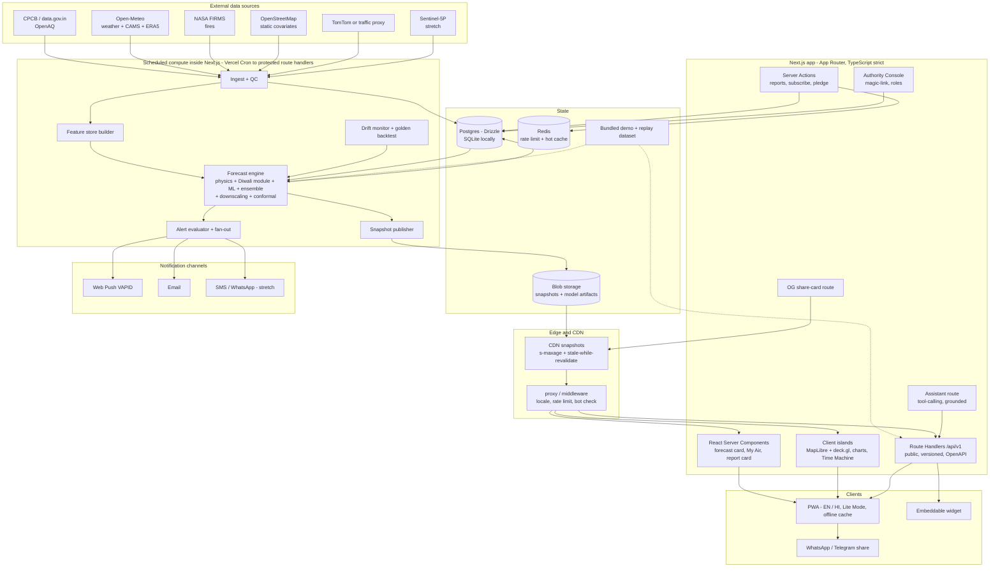
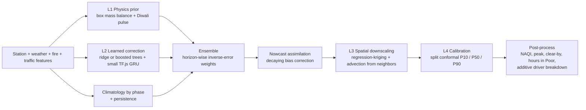
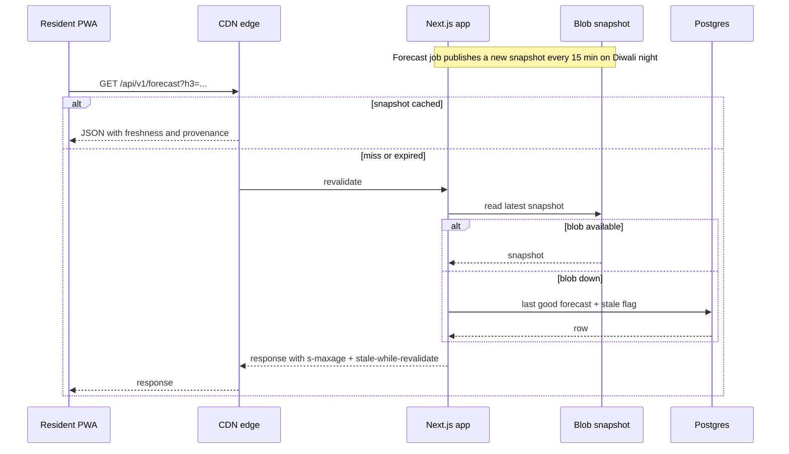

# 🪔 VayuNetra

**The eye that sees your air before it arrives.**
Street-level, explainable, AI-driven air-pollution forecasts for **before, during and after Diwali** — built 100% on Next.js.


> Built for the **Paryavaran Welfare Society Hackathon**
> Problem statement: *AI-Powered Neighborhood-Level Air Pollution Prediction System — predict neighborhood-level air pollution before, during and after Diwali using historical air-quality data, weather, traffic and other environmental indicators.*

---

## 🌬️ Why VayuNetra exists

On Diwali night, "Delhi AQI is 350" is almost useless. One colony bursts crackers while the next doesn't. Wind carries smoke across ward boundaries. A shallow inversion at 2 AM traps everything. The nearest monitoring station may be kilometres from your home.

VayuNetra forecasts the air **for your neighborhood, hour by hour**, tells you **why** it will be bad, **when it will clear**, **what to do about it**, and gives authorities a **what-if simulator and deployment planner** to act before the peak.

| | |
|---|---|
| **Know** | ~0.7 km² hex-cell forecast, T−72 h → T+72 h, with P10/P50/P90 uncertainty |
| **Understand** | Exact additive "Why is my air bad?" breakdown + wind-driven transport from neighboring cells |
| **Act** | Personal advice, safe windows, clear-by time, alerts · hotspot ranking, what-if Lab, deployment planner |
| **Trust** | Every value is labelled MEASURED / MODELLED / CITIZEN / SYNTHETIC; public backtest report card |

📄 Full product spec: [`docs/PRD.md`](./docs/PRD.md)

---

## ✨ Highlights

- 🗺️ **Hyperlocal hex heatmap** — H3 res-8 cells (zoom to res-9) rolled up into 30+ named Delhi-NCR micro-zones
- ⏳ **Diwali Time Machine** — scrub T−7 d → T+5 d; Build-up / Burst / Hangover phase chips; "Cracker Wave" animation; replay past Diwalis with **Forecast · Actual · Difference**
- 🧠 **Explainable by design** — additive driver split: baseline, still air, crackers, traffic, regional smoke, dust, neighbor transport
- 🔮 **Clear-by time** — "Peak ≈ 10:40 PM, Very Poor; likely clear by ≈ 11 AM"
- 🎛️ **What-if Lab** — cracker ban compliance, traffic, wind, dust, sprinkling; the **whole map recolours live**
- 🏛️ **Authority Console** — ward leaderboard, hotspot cards, **Deployment Planner** for anti-smog guns/sprinklers/patrols, PDF/CSV exports, audit log
- 🩺 **Health advisory engine** — deterministic, versioned, profile-based (child, elderly, asthma, outdoor worker …) + **Exposure Budget**
- 📣 **Citizen reports** — one tap, no accounts, cell-level only, ≥3 confirmations before influence, never overrides stations
- 💬 **Vayu assistant** — tool-grounded chat that cites cell, time and provenance; works with a template fallback if the LLM is down
- 🧪 **Honest validation** — leave-one-Diwali-out and leave-one-station-out backtests, interval calibration, skill vs persistence/climatology/CAMS
- 🛟 **Never down on Diwali night** — precomputed snapshots on CDN, degradation chain, last-good fallback, offline **Demo Mode**
- 🌐 **Reach** — English + Hindi, PWA, offline cache, Lite Mode, WhatsApp share cards, embeddable widget, open API
- 🎬 **Judge Mode** — one key launches a scripted 4-minute tour on real screens

---

## 🏗️ Architecture

**Principle: compute on a schedule, serve from the edge.** Forecasts are rebuilt hourly (every 15 min on Diwali night) and published as small snapshots. Users read snapshots from the CDN — a traffic spike never touches the model or the database.



### Prediction pipeline



### Diwali-night read path



### The Diwali Phase Engine

| Phase | Window (T = Diwali night) | Product behaviour |
|---|---|---|
| **Build-up** | T−7 d → T−6 h | Shopping-traffic hotspots, stagnation, early alerts, best outdoor days |
| **Burst** | Evening → ≈02:00 (learned from past Diwalis, not assumed from rules) | 15-min refresh, peak estimate, live reports, plume, targeted alerts |
| **Hangover** | T+6 h → T+5 d | Clear-by per cell, recovery tracker, ward Clean Air Score, impact report |

More detail: [`docs/ARCHITECTURE.md`](./docs/ARCHITECTURE.md) · [`docs/PRD.md`](./docs/PRD.md) §7, §11, §13.

---

## 🧰 Tech stack — "just Next.js", done properly

| Layer | Choice |
|---|---|
| Framework | Next.js (App Router, React Server Components, Route Handlers, Server Actions), React, TypeScript strict |
| UI | Tailwind CSS, shadcn/ui, Framer Motion, Lucide icons |
| Maps | MapLibre GL JS + deck.gl H3 hexagon layer (no map token needed) |
| Charts | Recharts / visx |
| State | TanStack Query (client data), `nuqs` (URL state → shareable views) |
| i18n | `next-intl` — English, Hindi (Punjabi stretch) |
| Geo | `h3-js`, Turf.js |
| Forecast engine | Pure TypeScript: physics prior, ridge/boosted regression, small TensorFlow.js GRU (pure-JS backend), regression-kriging, conformal calibration |
| Data | Drizzle ORM on Postgres (Neon) · SQLite for zero-setup local · Redis (Upstash) for rate limits and hot cache · Blob storage for snapshots and model artifacts |
| Scheduling | Vercel Cron → secret-protected route handlers (idempotent, job-logged) |
| AI assistant | Vercel AI SDK, tool-calling over our own forecast API; provider-agnostic; template fallback |
| Validation | Zod on every input and every external response |
| Auth | Email magic-link, roles (viewer / officer / admin) — officers only; citizens need no account |
| Notifications | Web Push (VAPID), email (Resend), WhatsApp share links (gateway = stretch) |
| PWA | Serwist / service worker, offline last-forecast, Lite Mode |
| Quality | Vitest, Playwright, MSW, Lighthouse CI, ESLint, Prettier, Husky + lint-staged |
| Hosting | Vercel (portable to any Node host) |

> No Python. No separate ML or backend service. Training is a TypeScript script in this repo; serving is pure-JS inference.

---

## 📊 Data sources

| Source | Used for |
|---|---|
| CPCB real-time network (data.gov.in) & OpenAQ | Ground truth, training, nowcast |
| Open-Meteo forecast + ERA5 | Wind, humidity, temperature, boundary-layer height, ventilation index |
| Open-Meteo air quality (CAMS) | Regional background, baseline to beat, fallback |
| NASA FIRMS (VIIRS) | Upwind crop-fire smoke index |
| OpenStreetMap (Overpass) | Roads, land use, markets, parks, built-up area |
| TomTom Traffic (free tier) / built-in proxy | Traffic index |
| Citizen reports (ours) | Weak local evidence, confidence |

Credit and attribution: CPCB, OpenAQ, Open-Meteo, NASA FIRMS, OpenStreetMap contributors (ODbL). Check each provider's terms and rate limits; notes live in [`docs/data-sources.md`](./docs/data-sources.md).

### Provenance labels (shown in the UI)

`MEASURED` station observation · `MODELLED` our estimate · `CITIZEN` user evidence · `SYNTHETIC` generated for dev/CI/demo, always with a banner.

---

## 🚀 Getting started

### Prerequisites
- Node.js 20+ (LTS)
- pnpm 9+
- Git

No cloud accounts are required to run locally: the app uses SQLite and a bundled dataset.

### Quick start (offline, no keys)

```bash
git clone https://github.com/<org>/vayunetra.git
cd vayunetra
pnpm install
cp .env.example .env.local
# keep DEMO_MODE=1 for a full offline experience
pnpm db:migrate
pnpm db:seed
pnpm dev
```

Open http://localhost:3000.
Press the **Judge Mode** shortcut (shown in the footer) for the scripted tour.

### Live mode (with keys)

1. Set `DEMO_MODE=0` and fill the keys in `.env.local` (see below).
2. Trigger the jobs once locally:

```bash
pnpm jobs:ingest
pnpm jobs:forecast
```

3. In production, Vercel Cron calls the same routes on a schedule (hourly; every 15 min on Diwali night).

### Environment variables

Names only — see `.env.example` for descriptions.

`DATABASE_URL` · `REDIS_URL` · `REDIS_TOKEN` · `BLOB_READ_WRITE_TOKEN` · `OPENAQ_API_KEY` · `DATA_GOV_IN_KEY` · `FIRMS_MAP_KEY` · `TOMTOM_API_KEY` · `VAPID_PUBLIC_KEY` · `VAPID_PRIVATE_KEY` · `RESEND_API_KEY` · `LLM_PROVIDER_KEY` · `CRON_SECRET` · `AUTH_SECRET` · `SENSOR_HMAC_SECRET` · `NEXT_PUBLIC_SITE_URL` · `DEMO_MODE` · `DEFAULT_CITY`

### Scripts

| Script | What it does |
|---|---|
| `pnpm dev` | Start the dev server |
| `pnpm build` / `pnpm start` | Production build / run |
| `pnpm lint` · `pnpm typecheck` · `pnpm format` | Quality gates |
| `pnpm test` | Unit and contract tests |
| `pnpm test:e2e` | Playwright end-to-end tests |
| `pnpm db:migrate` · `pnpm db:seed` | Schema and city-pack seed |
| `pnpm jobs:ingest` · `pnpm jobs:forecast` · `pnpm jobs:alerts` | Run scheduled jobs locally |
| `pnpm ml:train` | Train models offline; writes versioned artifacts to `models/` |
| `pnpm ml:backtest` | Leave-one-Diwali-out and leave-one-station-out evaluation |
| `pnpm city:build` | Build a city pack (OSM covariates, ward roll-ups) |

---

## 📂 Project structure

```
vayunetra/
├── src/
│   ├── app/
│   │   ├── (marketing)/              # landing, about, methodology
│   │   ├── (app)/
│   │   │   ├── map/                  # map + Time Machine + layers
│   │   │   ├── my-air/               # My Air (and /n/[slug])
│   │   │   ├── lab/                  # What-if Lab
│   │   │   ├── time-machine/         # replay of past Diwalis
│   │   │   ├── compare/
│   │   │   ├── report-card/
│   │   │   ├── report/               # citizen report
│   │   │   ├── pledge/
│   │   │   ├── status/               # data health
│   │   │   └── embed/
│   │   ├── (authority)/authority/    # console: leaderboard, hotspots, planner
│   │   ├── api/
│   │   │   ├── v1/                   # public versioned API + openapi.json
│   │   │   ├── cron/                 # ingest, forecast, alerts, drift (secret-protected)
│   │   │   └── og/                   # share-card images
│   │   ├── manifest + service worker
│   │   └── layout.tsx
│   ├── components/
│   │   ├── map/                      # hex layer, wind/plume, time scrubber, legend
│   │   ├── charts/                   # forecast band, waterfall, calibration
│   │   ├── advisory/                 # profile picker, advice cards, exposure budget
│   │   ├── authority/                # leaderboard, hotspot cards, planner
│   │   ├── assistant/                # chat rail, command palette
│   │   ├── judge-mode/               # scripted tour overlay
│   │   └── ui/                       # shadcn primitives
│   ├── server/
│   │   ├── ingest/                   # source adapters, QC, circuit breakers
│   │   ├── grid/                     # H3 helpers, neighborhood graph, covariates
│   │   ├── ml/                       # physics prior, event module, ridge, GRU, ensemble
│   │   ├── forecast/                 # downscaling, advection, conformal, attribution, clear-by
│   │   ├── scenario/                 # what-if engine + lookup grids
│   │   ├── planner/                  # deployment planner
│   │   ├── alerts/                   # evaluation, queue, channels
│   │   ├── advisory/                 # versioned health rules
│   │   └── db/                       # Drizzle schema and queries
│   ├── lib/                          # AQI/NAQI, provenance, i18n, config, formatting
│   └── types/
├── cities/
│   └── delhi-ncr/                    # city pack: bbox, wards.geojson, stations, rules.json, festival-calendar
├── data/
│   ├── bundled/                      # demo + replay dataset (offline)
│   └── fixtures/                     # sample API responses for contract tests
├── models/                           # versioned model artifacts + registry
├── scripts/                          # train, backtest, city build, job runners
├── messages/                         # en.json, hi.json
├── public/
├── docs/
│   ├── PRD.md
│   ├── ARCHITECTURE.md
│   ├── data-sources.md
│   ├── model-card.md
│   └── DEMO-SCRIPT.md
├── tests/                            # unit, contract, e2e
├── .github/
│   ├── workflows/                    # CI
│   ├── ISSUE_TEMPLATE/
│   └── pull_request_template.md
├── .env.example
└── README.md
```

---

## 🧪 How we prove it works

- **Leave-one-Diwali-out:** train on other years, test on the held-out Diwali.
- **Leave-one-station-out:** hide a station, predict it from the rest — our evidence for hyperlocal skill.
- **Baselines:** persistence, climatology, "same hour last year", raw CAMS.
- **Metrics:** MAE, RMSE, bias, NAQI category accuracy (exact and ±1), peak-time and peak-size error, skill scores, 80% interval coverage.
- **Public Report Card** inside the app, plus [`docs/model-card.md`](./docs/model-card.md) including weak spots.
- **CI golden backtest** fails the build if skill regresses.
- **Drift monitor** restores the previous model if live error breaches the backtest envelope.

Targets (hypotheses we report against, not claims): positive skill vs persistence at 24 h; 80% interval coverage within 75–85%; peak-time error within 2 h; category correct or ±1 in ≥85% of cell-hours.

---

## 🛡️ Resilience, privacy and ethics

- **Degradation chain:** healthy → stale source (wider bands) → no stations (CAMS prior + covariates, low confidence) → no live feeds (replay/climatology, offline banner).
- **Privacy:** no citizen accounts; location rounded to a cell in the browser; subscriptions deletable in one tap; optional microphone burst score is computed on-device and never uploaded; aligned with DPDP Act principles.
- **Abuse control:** bot check, rate limits, ≥3 independent confirmations, capped weight, never overrides stations.
- **Honesty:** modelled values are never presented as measurements; advice is general public guidance, **not medical advice**; authority tools support awareness and inspection prioritisation, not penalties against individuals.

---

## 🧭 Roadmap

- [x] PRD, architecture, README, repo skeleton
- [ ] Ingestion + QC + feature store
- [ ] Physics prior + Diwali event module + ridge → first forecast
- [ ] Snapshots + `/api/v1`
- [ ] Map, Time Machine, My Air, Why
- [ ] What-if Lab, Report Card
- [ ] Authority Console + Deployment Planner
- [ ] Alerts, citizen reports, pledge, assistant, share cards
- [ ] Hindi, PWA, Lite Mode, Judge Mode, polish
- [ ] Stretch: GRU member, Sentinel-5P overlay, WhatsApp/SMS gateway, second city pack, 3D view

Post-hackathon: more cities, community sensors, satellite inputs, year-round use, partnerships with RWAs, schools and city bodies.

---

## 🧑‍🤝‍🧑 Git workflow and repository setup

### One-time bootstrap

```bash
# 1. Create the app
pnpm create next-app@latest vayunetra --typescript --tailwind --eslint --app --src-dir --import-alias "@/*" --use-pnpm
cd vayunetra

# 2. UI foundation
pnpm dlx shadcn@latest init

# 3. Core dependencies
pnpm add maplibre-gl react-map-gl deck.gl @deck.gl/geo-layers h3-js @turf/turf
pnpm add recharts framer-motion lucide-react @tanstack/react-query nuqs next-intl zod
pnpm add drizzle-orm @upstash/redis @upstash/ratelimit @vercel/blob ai web-push
pnpm add @tensorflow/tfjs

# 4. Dev dependencies
pnpm add -D drizzle-kit vitest @playwright/test msw prettier husky lint-staged @lhci/cli

# 5. Initialise git and make the first commit
git init -b main
git add .
git commit -m "chore: bootstrap VayuNetra Next.js app"

# 6. Connect to GitHub (create an empty repo named vayunetra first)
git remote add origin git@github.com:<org>/vayunetra.git
git push -u origin main

# 7. Create the integration branch
git checkout -b develop
git push -u origin develop
```

### Recommended first commits (clean history for mentors)

```text
docs: add master PRD, README and architecture diagram
chore: add folder skeleton, city pack stub and bundled sample data
chore: configure eslint, prettier, husky and lint-staged
chore: add .env.example with all variable names
ci: add GitHub Actions for lint, typecheck, test and build
feat(ui): add design tokens, night-sky theme and NAQI palette
feat(api): stub /api/v1 routes with schema-validated fixtures
feat(map): render placeholder hex grid with time scrubber
```

### Branching

| Branch | Purpose |
|---|---|
| `main` | Always deployable; auto-deploys to production |
| `develop` | Integration branch; preview deploys |
| `feature/<area>-<short-name>` | e.g. `feature/map-time-machine`, `feature/ml-physics-prior` |
| `fix/<short-name>` | Bug fixes |
| `hotfix/<short-name>` | Urgent fixes off `main` |

Rules: protect `main` and `develop`; PR required; at least one review; CI must be green; squash-merge feature branches.

### Commit convention (Conventional Commits)

`feat:` · `fix:` · `docs:` · `chore:` · `test:` · `refactor:` · `perf:` · `ci:` — optional scope, e.g. `feat(forecast): add conformal intervals`.

### CI (GitHub Actions)

On every push and pull request: install with pnpm (cached) → lint → typecheck → unit and contract tests → golden backtest on bundled sample → production build. Pull requests additionally run Playwright smoke tests and Lighthouse CI against the preview deployment.

### Issue labels

`p0` · `p1` · `p2` · `frontend` · `backend` · `ml` · `data` · `design` · `bug` · `docs` · `demo-blocker`

### Ownership

| Owner | Area |
|---|---|
| A — Data & ML | Ingestion, QC, features, physics + event module, ensemble, backtests |
| B — Backend & infra | Database, API, cron, snapshots, alerts, deployment, CI, security |
| C — Frontend & map | Map, Time Machine, charts, My Air, plume, PWA, performance |
| D — Product & story | Design system, copy, Hindi, advisory rules, authority view, assistant prompts, demo |

---

## 🎬 Demo

Judge Mode runs a 4-minute tour on real screens: Diwali-night Time Machine → two adjacent wards → My Air with clear-by → Why → What-if (whole map recolours) → Forecast vs Actual and Report Card → Authority planner → assistant and live citizen report → scale and close.
Works offline via `DEMO_MODE=1`. Script: [`docs/DEMO-SCRIPT.md`](./docs/DEMO-SCRIPT.md).

---

## ⚠️ Disclaimer

VayuNetra provides modelled estimates for awareness and planning. It is **not** a medical device and **not** a replacement for official CPCB data or advisories. Neighborhood values away from monitoring stations are estimates and are labelled with their confidence.

---

## 🤝 Team

Built by a four-student team for the Paryavaran Welfare Society Hackathon.
`<Team name>` — `<member A>` · `<member B>` · `<member C>` · `<member D>`

## 📄 License

MIT — see [`LICENSE`](./LICENSE). Data from third-party providers remains subject to their own terms.

## 🙏 Acknowledgements

CPCB and state pollution control boards, OpenAQ, Open-Meteo and the Copernicus Atmosphere Monitoring Service, NASA FIRMS, OpenStreetMap contributors, Uber H3, MapLibre, deck.gl, and the Paryavaran Welfare Society for the challenge.
